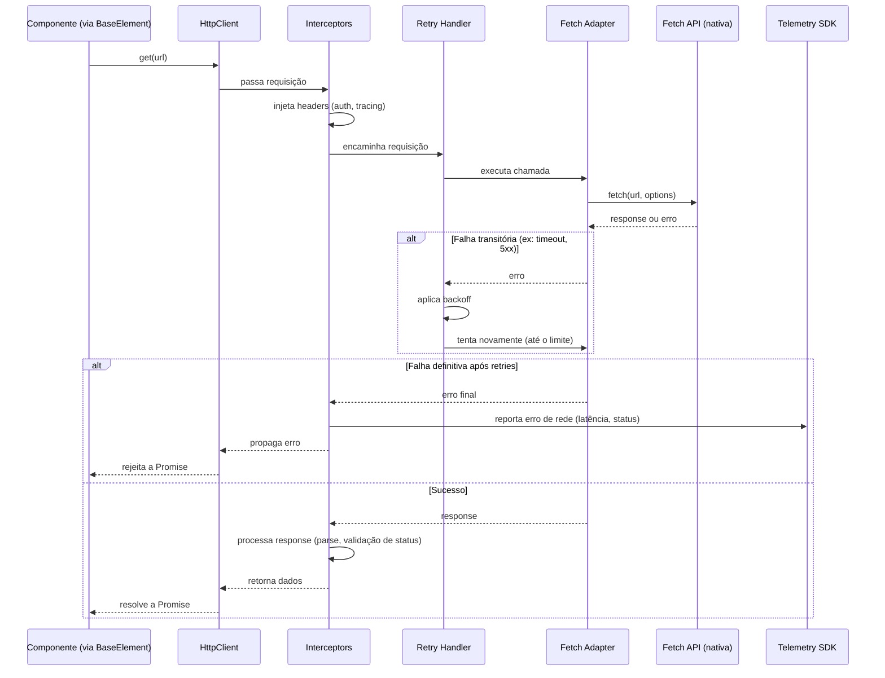

# C4 Model — Nível 4: Code

> Referência: ADR-001 (adoção do C4 Model), nível **opcional**.

## Política deste nível

Diferente dos três níveis anteriores (Context, Container, Component), o nível Code **não é obrigatório** para a plataforma PingPong WebComponents, conforme definido no ADR-001:

> "O nível Code é opcional e poderá ser omitido sempre que o próprio código-fonte TypeScript for suficientemente autoexplicativo."

Isso é intencional, não uma lacuna de documentação. Manter um diagrama de classes completo, atualizado a cada mudança de implementação, gera overhead desproporcional para um projeto com mantenedor único (ADR-001) e tende a ficar desatualizado rapidamente — violando o Princípio 3 do ADR-001 ("Diagramas devem representar a realidade atual do sistema").

Este arquivo, portanto, documenta **apenas os trechos de lógica que não são óbvios a partir do código-fonte em si** — fluxos não lineares, ordens de execução que não ficam claras lendo uma classe isolada, ou decisões de implementação que merecem explicação adicional. Tudo o que for autoexplicativo (nomes de classes, tipos, assinaturas de método) fica de fora, por design.

## O que está documentado aqui

| Fluxo | Por que precisa de diagrama |
|---|---|
| Pipeline de interceptors do `HttpClient` | Ordem de execução não-linear, envolve múltiplos componentes do container `networking` (ADR-004) |

## O que **não** está documentado aqui (e por quê)

- Classes individuais de componentes `pp-*` — assinatura e propriedades já são claras pelo próprio TypeScript, com tipagem estrita (ADR-002).
- Estrutura interna do `Payload Validator` ou `Error Boundary` (`foundation`) — lógica linear de validação, sem ramificação complexa o suficiente para justificar um diagrama.
- Estrutura de tokens do `design-system` — é uma lista de valores, não um fluxo.

Se, à medida que a implementação avançar, outro trecho se mostrar genuinamente complexo (por exemplo, a lógica de retry com backoff, ou uma futura lógica de sampling do Telemetry SDK), ele deve ser adicionado aqui — e só então.

---

## Fluxo: Pipeline de Interceptors do `HttpClient`

Este é o único fluxo, até o momento, com ordem de execução complexa o suficiente para justificar um diagrama de sequência. Ele mostra o que acontece internamente no container `networking` (ADR-004) quando um componente faz uma requisição no Modo 1 (self-fetch).

### Pontos relevantes do fluxo

- O **Retry Handler** só reentra no ciclo em falhas consideradas transitórias (timeout, erros 5xx). Erros 4xx não acionam retry, por não serem recuperáveis com uma nova tentativa idêntica.
- A telemetria (`Telemetry SDK`, ADR-005) é acionada pelos **Interceptors**, não pelo `HttpClient` diretamente — isso mantém o `HttpClient` desacoplado da ferramenta de observabilidade escolhida.
- Este fluxo se aplica apenas ao **Modo 1 (self-fetch)**. No Modo 2 (payload fornecido), nada deste diagrama é executado — ver `c4-component.md`, container `foundation`, para o fluxo equivalente de validação de payload.

---

## Observações

- Este arquivo deve permanecer **deliberadamente curto**. Se ele começar a crescer com diagramas de classe completos, é um sinal de que a equipe está documentando no nível errado — nesse caso, revisitar o ADR-001.
- Quando a plataforma adotar geração automática de documentação (ex: TypeDoc), este nível pode ser parcialmente substituído por um link para a documentação gerada a partir do código, reduzindo ainda mais a necessidade de manutenção manual aqui.
