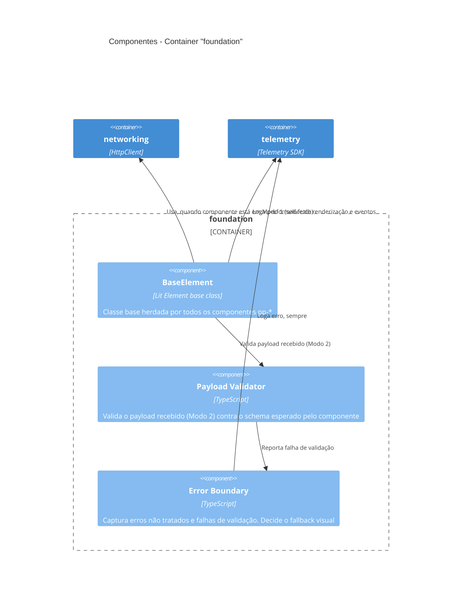
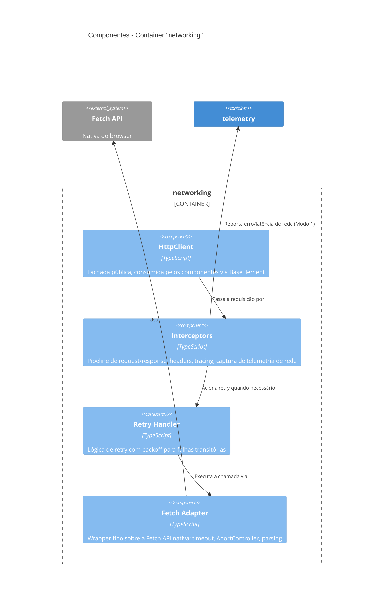
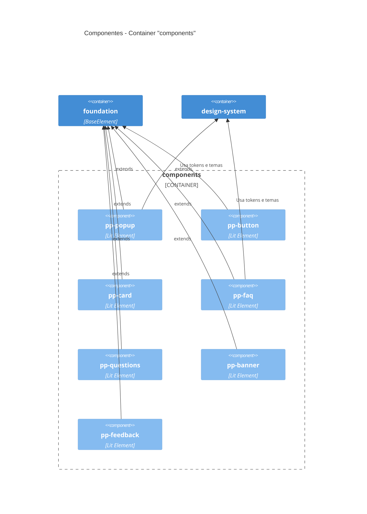

# C4 Model — Nível 3: Component

> Referência: ADR-001 (adoção do C4 Model), nível obrigatório.

## Visão Geral

Este nível faz o zoom-in **dentro** de cada container definido em `c4-container.md`, detalhando seus principais blocos internos e responsabilidades. Nem todo container precisa de um diagrama de componentes — aqui estão detalhados os três containers com complexidade suficiente para justificar o detalhamento: `foundation`, `networking` e `components`. Os containers `design-system` e `telemetry` podem ser detalhados aqui futuramente, se e quando a complexidade interna justificar.

---

## Container: `foundation`

**Responsabilidades:**
- `BaseElement`: ponto de herança único de todos os componentes (ADR-002). É quem decide, com base no que o componente recebe, se está em Modo 1 (self-fetch) ou Modo 2 (payload fornecido) (ADR-004).
- `Payload Validator`: valida o schema do payload recebido no Modo 2, antes da renderização (ADR-005).
- `Error Boundary`: centraliza a captura de erro — payload inválido, exceção não tratada — decidindo entre renderizar um fallback visível ou suprimir a renderização, conforme a criticidade do componente (ADR-005).

---

## Container: `networking`

**Responsabilidades:**
- `HttpClient`: única API pública exposta aos componentes (ADR-004).
- `Interceptors`: ponto de extensão para autenticação, tracing e telemetria, sem alterar os componentes consumidores.
- `Retry Handler`: resiliência a falhas transitórias, com backoff configurável.
- `Fetch Adapter`: isola o uso direto da Fetch API nativa, concentrando timeout e cancelamento via `AbortController`.

---

## Container: `components`

**Responsabilidades:**
- Cada `pp-*` é um Custom Element independente, que herda de `BaseElement` e não implementa lógica própria de fetch, validação ou telemetria — tudo isso é resolvido pela camada `foundation` (ADR-002, ADR-005).
- A lista de componentes aqui reflete os exemplos já citados nos ADR-002 e ADR-003. Conforme novos componentes forem criados (ver `ROADMAP-V1.md`, fase *Components Phase*), este diagrama deve ser atualizado.

---

## Observações

- Este nível é o que mais vai mudar com o tempo — à medida que novos componentes, interceptors ou validadores forem adicionados, os diagramas aqui devem ser atualizados para refletir a realidade do código (Princípio 3 do ADR-001).
- Os containers `design-system` e `telemetry` não têm diagrama de componentes ainda porque sua estrutura interna (tokens, fluent-adapter / RUM, error tracking, logs) está suficientemente descrita nos próprios ADR-003 e ADR-005. Criar esse detalhamento aqui só se a complexidade interna justificar.
