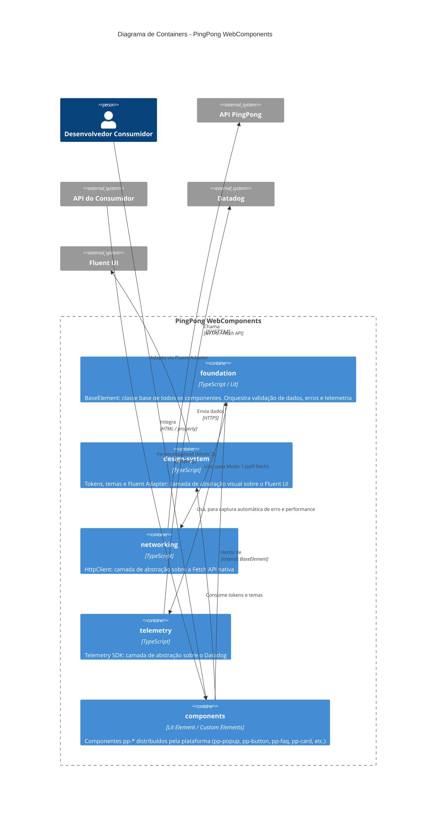

# C4 Model — Nível 2: Container

> Referência: ADR-001 (adoção do C4 Model), nível obrigatório.

## Visão Geral

Este diagrama faz o zoom-in do nível Context, mostrando os principais "containers" da plataforma — neste caso, pacotes NPM independentes e versionáveis que compõem a arquitetura da PingPong WebComponents. Cada container corresponde a uma pasta/pacote já definido nos ADRs e presente na estrutura do repositório.

## Diagrama

## Containers

| Container | Responsabilidade | ADR de origem |
|---|---|---|
| `foundation` | `BaseElement`, herdado por todos os componentes. Centraliza validação de payload, captura de erro e orquestração de dados/telemetria | ADR-002, ADR-004, ADR-005 |
| `design-system` | Tokens, cores, tipografia, temas e o Fluent Adapter. Nenhum componente acessa o Fluent UI diretamente | ADR-003 |
| `networking` | `HttpClient`: timeout, retry, cancelamento, interceptors, tratamento de erro padronizado, sobre a Fetch API nativa | ADR-004 |
| `telemetry` | Telemetry SDK: RUM, error tracking, logs customizados, sobre o Datadog | ADR-005 |
| `components` | Os componentes `pp-*` em si, construídos com Lit Element v3 | ADR-002 |

## Containers Externos

| Container Externo | Papel |
|---|---|
| API PingPong | Consumida pelo `networking` quando o componente está no Modo 1 (self-fetch) |
| API do Consumidor | Fonte do payload no Modo 2 — fora do controle da plataforma, resolvida pela aplicação que integra o componente |
| Datadog | Destino final da telemetria, nunca acessado fora do `telemetry` |
| Fluent UI | Implementação visual de base, nunca acessada fora do `design-system` |

## Containers Futuros (Roadmap)

Conforme `ROADMAP-V1.md`, a fase *Developer Experience* prevê containers adicionais que ainda não fazem parte deste diagrama por não terem ADR próprio:

- **Storybook** — catálogo visual dos componentes
- **Playground** — ambiente de testes interativos
- **Component Generator** — scaffolding de novos componentes

Esses containers deverão ser adicionados a este diagrama quando houver decisão arquitetural (ADR) ou implementação concreta que justifique sua inclusão.

## Observações

- Nenhum container acessa um sistema externo diretamente sem passar por uma camada de abstração própria — esse é o princípio fundamental repetido nos ADR-003, ADR-004 e ADR-005: `Componente → Abstração própria → Adapter → Implementação externa`.
- O container `components` depende de **todos os outros quatro containers internos**, o que o torna o ponto de maior acoplamento interno da plataforma — e também o motivo pelo qual `foundation` concentra tanta responsabilidade (ver `c4-component.md`).
