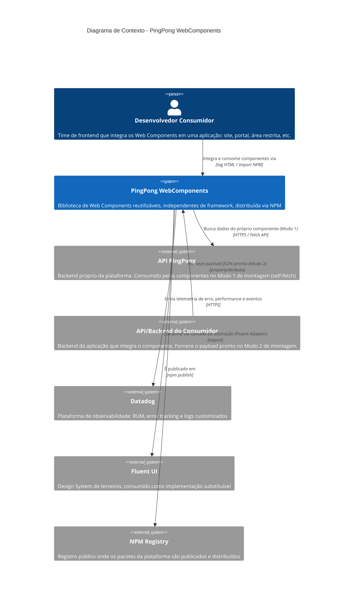

# C4 Model — Nível 1: Context

> Referência: ADR-001 (adoção do C4 Model), nível obrigatório.

## Visão Geral

Este diagrama representa a plataforma **PingPong WebComponents** em seu nível mais alto de abstração: o que o sistema é, quem o utiliza e com quais sistemas externos ele se relaciona. Não entra em detalhes técnicos internos — isso fica para os níveis Container e Component.

## Diagrama

## Elementos

| Elemento | Tipo | Descrição | ADR relacionado |
|---|---|---|---|
| Desenvolvedor Consumidor | Pessoa | Time que embute os componentes `pp-*` em uma aplicação | — |
| PingPong WebComponents | Sistema (foco) | A própria plataforma de componentes | ADR-001, ADR-002 |
| API PingPong | Sistema externo | Backend da plataforma, usado no Modo 1 (self-fetch) | ADR-004 |
| API/Backend do Consumidor | Sistema externo | Backend de quem integra o componente, usado no Modo 2 (payload fornecido) | ADR-004 |
| Datadog | Sistema externo | Observabilidade (RUM, erros, logs) | ADR-005 |
| Fluent UI | Sistema externo | Design System base, por trás da camada de abstração própria | ADR-003 |
| NPM Registry | Sistema externo | Canal de distribuição dos pacotes | ADR-002 |

## Escopo e Fora de Escopo

**Dentro do escopo deste nível:**
- Quem usa a plataforma (o desenvolvedor consumidor)
- Com quais sistemas externos a plataforma troca dados ou depende tecnicamente

**Fora do escopo** (detalhado nos níveis seguintes):
- Como os pacotes internos (`foundation`, `networking`, `telemetry`, `design-system`, `components`) se organizam — ver `c4-container.md`
- Como os componentes internos de cada pacote funcionam — ver `c4-component.md`

## Observações

- A plataforma se relaciona com **duas APIs distintas e não com uma só**, dependendo do modo de montagem do componente (ADR-004): a API da própria PingPong (Modo 1) ou a API do consumidor (Modo 2). Isso é intencional e está detalhado no ADR-004.
- Fluent UI e Datadog nunca são acessados diretamente pelos componentes — sempre através das camadas de abstração (`design-system/` e `telemetry/`, respectivamente), conforme ADR-003 e ADR-005. Esse detalhe de implementação é mostrado no nível Container.
